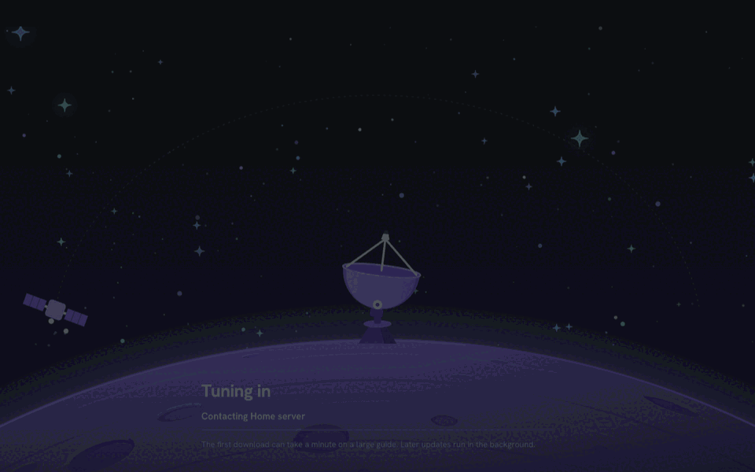
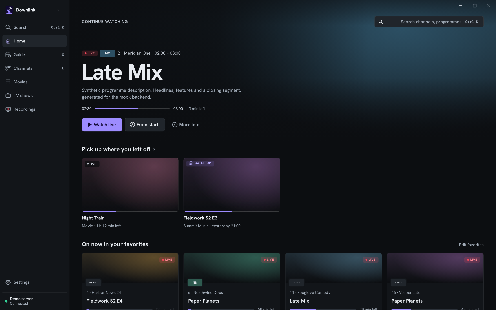
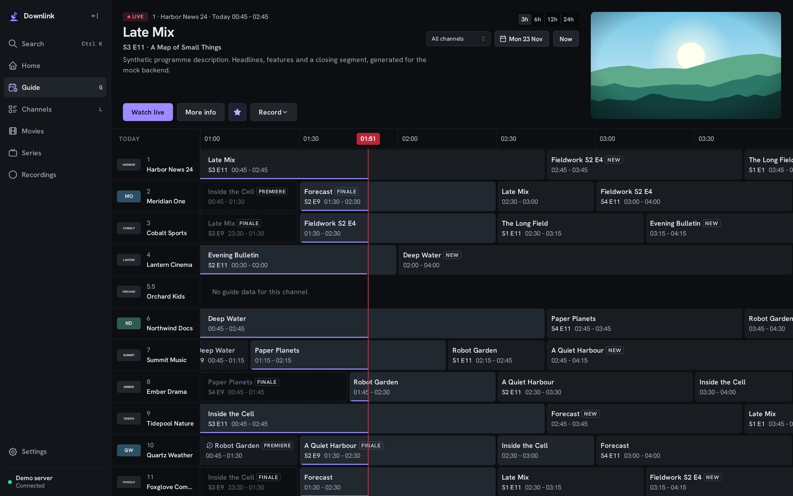
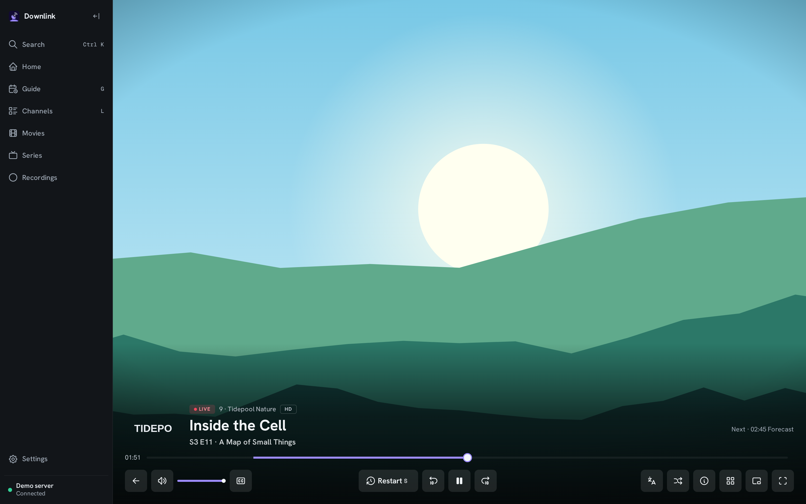
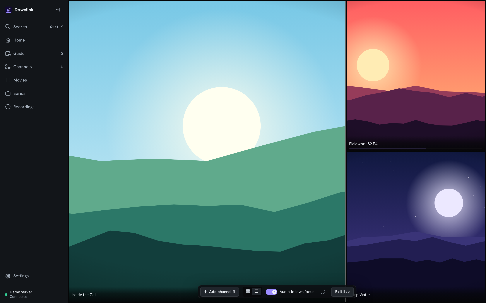
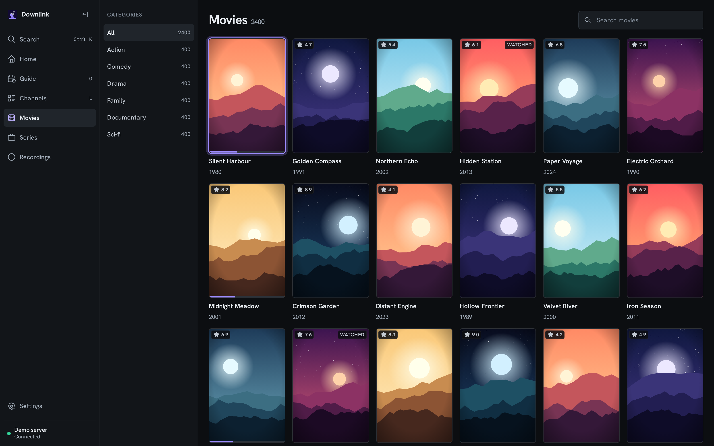
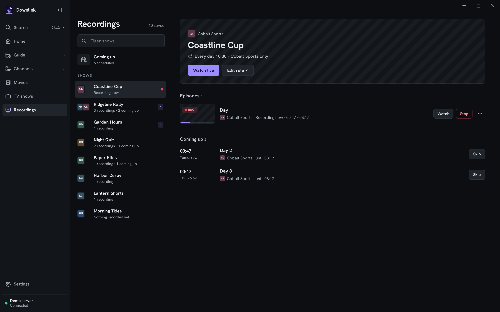

  

<h1 align="center">Downlink</h1>

Cross Platform desktop IPTV client for Dispatcharr, M3U/XMLTV playlists and Xtream accounts.

  
  
  
  

---

# What Is Downlink
I wanted a desktop IPTV player that could take advantage of all Dispatcharr offers. Support for Live channels, VOD, and DVR. Fast, easy to use, and reliable.

While not required, this app is best used with [Dispatcharr](https://github.com/dispatcharr/dispatcharr).

## Features

- TV guide with now/next, local search of program titles and descriptions.
- Catch-up and "restart this program" on sources that offer an archive (Dispatcharr).
- Full support for VOD content
- When using Dispatcharr, manage your DVR and recordings
- Fast channel changes: the playback engine is pre-warmed and nothing waits on the network before a zap.
- Playback powered by MPV: H.264, HEVC, MPEG-2, AC-3/E-AC-3, teletext, hardware decode where the
  machine allows it.
- Full HDR Support: Correctly plays both SDR and HDR content on all display types with tone mapping where required
- Multiview: Play multiple streams at once in different grid layouts and switch the active audio
- System tray, media keys and OS media controls (MPRIS, Windows media overlay, macOS Now Playing), keeps the screen awake while playing, pauses and releases the stream when the machine sleeps.
- Single instance and `downlink://channel/<uuid>` deep links.
- Updates through signed releases, checked in the background and installed when you quit. Never mid-playback.
- Your credentials live in the operating system keychain and are never written to the database or the logs.

## Screenshots

_All screenshots use synthetic test data. Channels, programmes and artwork are made up._

| | |
|:---:|:---:|
|  **Home** |  **Guide with live preview** |
|  **Now playing** |  **Multiview** |
|  **Movies** |  **Recordings** |

## Getting started

1. Start Downlink and choose **Add a source**.
2. For Dispatcharr, enter the server address and an API key (Dispatcharr: user menu, API keys).
3. Wait for the first sync, then pick a channel.

## Legal

Downlink is a media player. It does not provide, host, sell or link to any content, and it has no knowledge of what
you play. You are responsible for making sure that you have the right to access and watch the streams you add, under
the laws that apply to you and the terms of your provider. The authors accept no liability for how the software is
used. This is not legal advice.

Downlink contains and bundles mpv/libmpv (GPL) and FFmpeg libraries; their licences apply to those parts.

## Licence

GPL-3.0-or-later. See [`LICENSE`](LICENSE).
